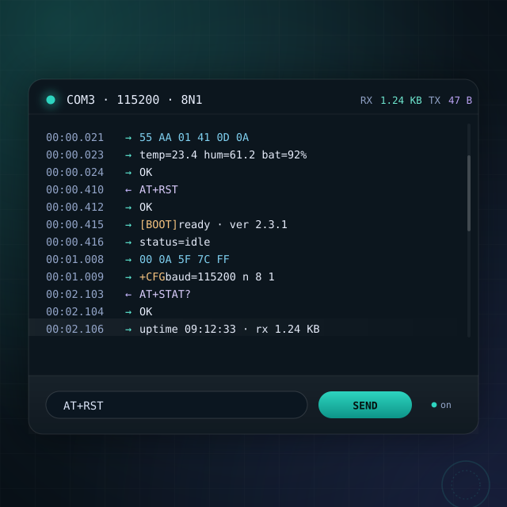

# Serial Monitor

Serial data monitor — receive area (CodeMirror 6) + send bar (Monaco) + sidebar settings. LinkDesk's first view plugin; the universal container infrastructure was validated here. Not tied to any particular use.



## What it does

- Sidebar / panel surfaces: Serial Monitor.
- 28 commands, available from the Command Palette and the Plugin Store's Features tab.
- 2 settings, editable in Settings.

## Views

- **Serial Monitor Sessions**
- **Send/Receive**

## Commands

| Command | What it does |
|:--|:--|
| `serial-monitor.copy` — Copy | Copy the text selected in the receive area to the clipboard. |
| `serial-monitor.selectAll` — Select All | Select all content in the receive area. |
| `serial-monitor.clear` — Clear Receive | Clear the receive area (including syntax-highlighting decorations). |
| `serial-monitor.clearSend` — Clear Send | Clear the send input box. |
| `serial-monitor.togglePause` — Toggle Pause Receiving | Pause/resume receive-area refresh (data is buffered while paused and shown after resuming). Pass sessionId to target a session (default: active session). Returns { ok, sessionId, name, field, value, previous } with field always paused. Paused is view state, not session-table state—if the target session has no tab open, returns no-view instead of dereferencing null. The command-palette title is always the action name "Toggle Receive Pause" (never state-dependent): pause state is per tab, while the title slot is global, so a state-dependent title would lie. |
| `serial-monitor.exportLog` — Export Log | Export the current receive-area content to a .txt log file (opens a save dialog). |
| `serial-monitor.toggleSendMode` — Toggle Send Format (Text / HEX) | Switch between text and HEX sending (same as the toggle in the send bar). Pass sessionId to target a session (default: active session). Returns { ok, sessionId, name, field, value, previous } with field always sendMode; value is read back after the change. The title is always the action name (never state-dependent; multi-session shares one title slot), so read state from the result's value or serial-monitor.listSessions—never from the title. |
| `serial-monitor.toggleEcho` — Toggle Echo | Toggle echo of sent content in the receive area. Pass sessionId to target a session (default: active session). Returns { ok, sessionId, name, field, value, previous } with field always showEcho (value read back after the change). The title is always the action name (multi-session shares one title slot), so read state from the result's value or listSessions. |
| `serial-monitor.toggleLineNumbers` — Toggle Line Numbers | Show/hide receive-area line numbers. Pass sessionId to target a session (default: active session). Returns { ok, sessionId, name, field, value, previous } with field always showLineNumbers (value read back after the change). The title is always the action name, so read state from the result's value or listSessions. |
| `serial-monitor.toggleSystemLog` — Toggle Separate System Log | Toggle "separate system messages" (show system messages apart from data). This is a per-session setting—under multiple ports, sessions do not affect each other; name the target with sessionId (do not guess by switching tabs). Returns { ok, sessionId, name, field, value, previous } with field always separateSystemLog (value read back after the change). The title is always the action name, so read state from the result's value or listSessions. |
| `serial-monitor.toggleAutoRepeat` — Toggle Auto Resend | Toggle auto-repeat. Pass sessionId to target a session (default: active session). Returns { ok, sessionId, name, field, value, previous } with field always autoRepeat (value read back after the change). The title is always the action name, so read state from the result's value or listSessions. |
| `serial-monitor.toggleAutoClear` — Toggle Auto Clear | Toggle auto-clear. Pass sessionId to target a session (default: active session). Returns { ok, sessionId, name, field, value, previous } with field always autoClear (value read back after the change). The title is always the action name, so read state from the result's value or listSessions. |
| `serial-monitor.quickSendFill` — Fill to Send | Fill the send input with a quick-send item's content (without sending). |
| `serial-monitor.quickSendEdit` — Edit | Enter edit mode for a quick-send item (same as right-click → Edit on its pill). The editor is view state, so the session's serial tab must be mounted. |
| `serial-monitor.quickSendDelete` — Delete | Delete a quick-send item (same as right-click → Delete on its pill). No view required; session data is module-level. |
| `serial-monitor.openPort` — Open Port | Open a serial port—optionally specify COM port / baud rate / frame format (data bits, stop bits, parity); uses the same path as clicking Open in the UI (sidebar light and session table move together). If already open, does nothing (when the device is present). If the table says open but the device has disappeared from the port list (a zombie handle left by unplugging), the handle is cleared and it honestly returns {ok:false, code:EDEVICE} instead of claiming it is already open; after replugging, serial-monitor.reopen restores it in one step. No view required. With multiple sessions, portName must be paired with sessionId: portName alone rebinds the active session's port, and the active session follows the foreground tab (same command, two outcomes)—such calls are rejected with each session's current port and the fix. The result includes previousPortName (the port before rebinding; null if unbound). |
| `serial-monitor.closePort` — Close Port | Close an open serial port (explicitly turn off its light, using the same write path as the UI). If not open, honestly returns alreadyClosed instead of pretending. The result's sessionId is the port's **owning session** (not merely the resolved session—a real-device bug once reported session 49 when closing COM3 owned by 48); if another session was named, requestedSessionId is included. |
| `serial-monitor.closeSession` — Close Serial Session | Close a serial session (same as ✕ on a sidebar session row): disconnect the port if open, close the tab, then remove the session. When the "confirm on close" setting is on and confirm is not passed, show a confirmation dialog (declining does nothing and returns denied). |
| `serial-monitor.setSendCoding` — Set Send Encoding | Set this session's send encoding (same as the sidebar Send Encoding dropdown)—UTF-8 / GB2312 / Shift-JIS / Latin-1. A one-off encoding for a single message goes through serial-monitor.send's encoding argument and does not change this setting. |
| `serial-monitor.send` — Send | Send data to the serial port (text or HEX)—text may specify an encoding (default: the target session's send encoding). Without portName, uses the "unique default port" semantics. when=false: programmatic only; not shown in the command palette. |
| `serial-monitor.readSince` — Read Received Data | Pull-style read—return the receive log segment selected by the read mode in arrival order (cursor = the cursor from the previous result). This is not a subscription: one request, one response, shaped for CLI/MCP. Choose exactly one mode (mutually exclusive): since (cursor) / tail (last N) / afterMark (named cursor); prefix / grep are orthogonal server-side filters (the cursor still advances; the result includes scanned/matched). Passing nothing returns {ok:true, noop:true, reason:cursor-required, cursor:current-watermark}—it **does not replay 200 historical lines** (treating old logs as new is a misdiagnosis root); pass since:0 explicitly for the whole buffer (result includes history:true). Three result states: new data {ok:true, items, cursor, count, lost} / nothing new {ok:true, noop:true, reason:no-new-data} / invalid call {ok:false, noop:true, reason:bad-since|bad-tail|bad-limit|bad-port|bad-prefix|bad-grep|bad-until|bad-timeout|mode-conflict|cursor-ahead|no-serial-face} or failure {ok:false, code:EBADARGS|ENOMARK|EDEVICE}. lost = entries rolled out of the buffer and no longer readable (greater than 0 means you are behind; includes other ports—the cursor is a global position). limit above the cap (1000) is clamped with truncated:true (never silently truncated). Each item carries seq / portName / text (wire-exact) / hex / ts / uptimeMs (monotonic milliseconds from this port's latest openPort, restarting near 0 after reconnect; null when unknown). The result includes state:{paused, portOpen, devicePresent} when portName is named or exactly one bound session exists; null when the port cannot be determined—paused is **view pause** (freezes display only) and does not affect AI reads; data is still received. untilRegex: the server blocks until a matching line, timeoutMs required (1–60000 ms, no infinite waits) and must be below the CLI/command-layer timeout, otherwise the command layer times out first and timedOut is never seen. Hit: {ok:true, matched:true, line, cursor, tookMs}; timeout: {ok:true, matched:false, timedOut:true, cursor, tookMs} (timeout is not an error). No view required; the port remains owned by LinkDesk—the AI never opens it itself. when=false: programmatic only; not shown in the command palette. |
| `serial-monitor.receiveStatus` — Receive Buffer Status | Read receive-surface watermarks without pulling data: current cursor, the oldest sequence in the buffer (first), retained count, capacity, the global last-received time (lastDataAt) and idleMs since then (null if never), plus per port {portName, count, open, devicePresent, lastDataAt, idleMs, state:{paused, portOpen, devicePresent}}—open state comes from the main process getStatus (the source of truth); devicePresent comes from the plugin's port enumeration (false when unplugged, null when unreadable—never guessed); paused is view pause (freezes display only, does not affect AI reads; null when no view is mounted). Use it to distinguish "port closed / open but silent / device unplugged / UI paused" before deciding whether to read. No view required. when=false: programmatic only; not shown in the command palette. |
| `serial-monitor.listSessions` — List Serial Sessions | Read the session surface: which sessions exist, which is active, and each session's port and I/O settings (sessionId / name / portName / open / devicePresent / stale / viewMounted / paused / baudRate / sendMode / sendCoding / receiveCoding / showEcho / showLineNumbers / separateSystemLog / autoRepeat / autoClear). With multiple ports, sessions are **parallel** (one port, one settings set, one tab each)—read this first to get a sessionId for session commands (toggle* / setSendCoding / closeSession…). viewMounted = whether a tab is mounted for that session (view-state commands such as copy / clear / togglePause depend on it); paused is null when not mounted (never false pretending it was queried). devicePresent = whether the port's device is still in the port list (false when unplugged, null when unreadable); stale = open is true while devicePresent is definitively false ("the table says open but the device is gone"—after USB replug, use this to decide who needs reopen). No view required. when=false: programmatic only; not shown in the command palette. |
| `serial-monitor.listPorts` — List Serial Ports | Read the hardware surface: which serial ports exist on this machine (the same path as the UI Port dropdown, so readings cannot diverge from the UI). Each returns {portName, description, open, sessionId}—open is the plugin's authoritative per-port state (the same as the sidebar light), sessionId is the bound session (null if unbound). To target a port, read this first to pick portName (then listSessions for sessionId); only exec is exposed—do not guess port names. No ports returns {ok:true,count:0,ports:[]} (not an error); enumeration failure returns {ok:false,noop:true,reason:read-failed}—"cannot ask" is not "no ports". No view required. when=false: programmatic only; not shown in the command palette. |
| `serial-monitor.reopen` — Reopen port | One-step recovery after a USB replug: closePort → wait briefly (200 ms) → openPort (same session, same parameters—baud/frame/encoding read from the owning session). Success returns {ok:true, sessionId, portName, recovered:true, tookMs}. Device absent (port missing from the list) returns {ok:false, code:EDEVICE, hint}—there is no automatic reconnect polling; the port number may change, so check serial-monitor.listPorts before naming portName. A port bound to no session returns ENOSESSION (no parameters to reuse). Also use it to explicitly reopen when the device is present but the handle is suspected dead. No view required. when=false: programmatic only; not shown in the command palette. |
| `serial-monitor.mark` — Mark cursor | Name the current cursor watermark (a named cursor stored in plugin memory—lost on pool page reload): serial-monitor.mark {"name":"boot-start"} → {ok:true, name, cursor, sessionId, previous}. Reuses the name to overwrite; previous is the old cursor. cursor is returned too, so callers may store it themselves. Later serial-monitor.readSince {"afterMark":"boot-start"} reads forward from here; a missing mark returns {ok:false, code:ENOMARK}. No view required. when=false: programmatic only; not shown in the command palette. |
| `serial-monitor.query` — Send and await reply | Send a command and wait for the device's reply—one call replaces send → sleep → readSince (the server absorbs the race). Internally: record cursor → sendText (session send encoding) → server blocks for expect (**substring match**, so regex metacharacters in AT replies are harmless) → return the matching line and lines received along the way. Hit: {ok:true, matched:true, line, lines, elapsedMs, cursor}; timeout: {ok:true, matched:false, timedOut:true, lines, elapsedMs, cursor} (lines = what arrived; timeout is not an error); concurrent query on the same port returns {ok:false, code:EBUSY} (no queueing); send failure returns ESENDFAIL; unplug while waiting returns EDEVICE. timeoutMs is required (1–60000 ms, no infinite waits) and must be below the CLI/command-layer timeout. No view required. when=false: programmatic only; not shown in the command palette. |
| `serial-monitor.reset` — Reset board | Reset the board electrically via DTR/RTS (uses existing serial capabilities only, zero new IPC): assert low → wait holdMs (default 100 ms) → release; method=both toggles DTR and RTS in phase. Success returns {ok:true, portName, method, holdMs, tookMs} (tookMs under 1 s, replacing a 20 s reflash-as-reset). This is an electrical reset: it works only when the board wires a reset circuit (most dev boards do; without one the command succeeds but the board does not reboot—a hardware fact, not an error). Port not open returns {ok:false, code:ENOPORT}. No view required. when=false: programmatic only; not shown in the command palette. |

## Settings

- **Connection Indicator** (`serial-monitor.statusBar.connection`) — Show connection indicator in status bar
- **Confirm on Close** (`serial-monitor.confirmOnClose`) — Prompt on Close

## Install

Open the Plugin Store, find this plugin, and click Install. For offline use, install the `.linkdesk-plugin` package from disk.

## Development

```bash
npm install
npm run dev      # preview in the dev host
npm run lint     # eslint + manifest i18n completeness
npm run verify   # full repository gate
npm run build    # produce the .linkdesk-plugin package
npm run publish  # GitHub Release + catalog entry
```

See the repository root `README.md` for the Chinese documentation and the full directory contract.
